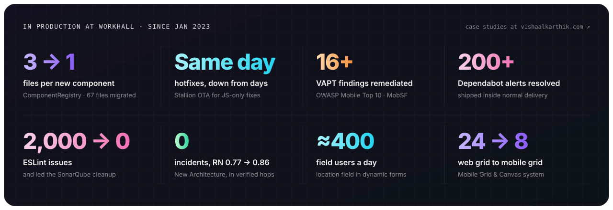
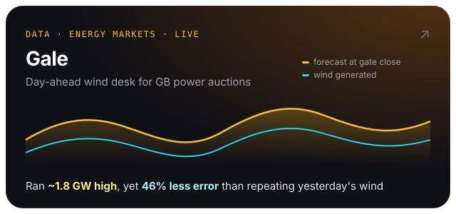
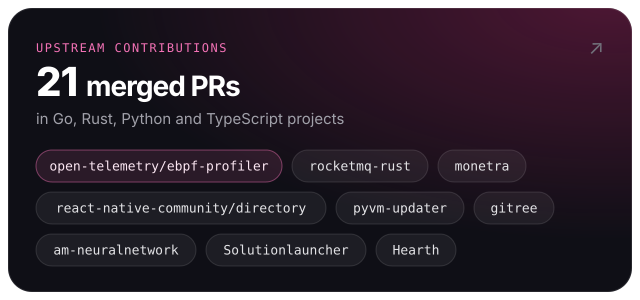

### ✍️ Writing

- [The Hotfix Was Ready. The App Store Wasn't.](https://javascript.plainenglish.io/the-hotfix-was-ready-the-app-store-wasnt-9d684386d865)
- [From a Giant Switch to a Component Registry in React Native](https://javascript.plainenglish.io/from-a-giant-switch-to-a-component-registry-in-react-native-64eb153870d4)
- [The React Native Upgrade I Didn't Want to Do in One Shot](https://blog.stackademic.com/the-react-native-upgrade-i-didnt-want-to-do-in-one-shot-a4aa8d25a6e0)
- [Target API 36: The Android 16 Change That Caught Us by Surprise](https://blog.stackademic.com/target-api-36-the-android-16-change-that-caught-us-by-surprise-59f342aba431)

### 🤝 Get in touch

Certified: Oracle Multicloud Architect · AWS Cloud Practitioner · Azure Fundamentals &nbsp;·&nbsp; Numbers from npm and GitHub, November 2026.
